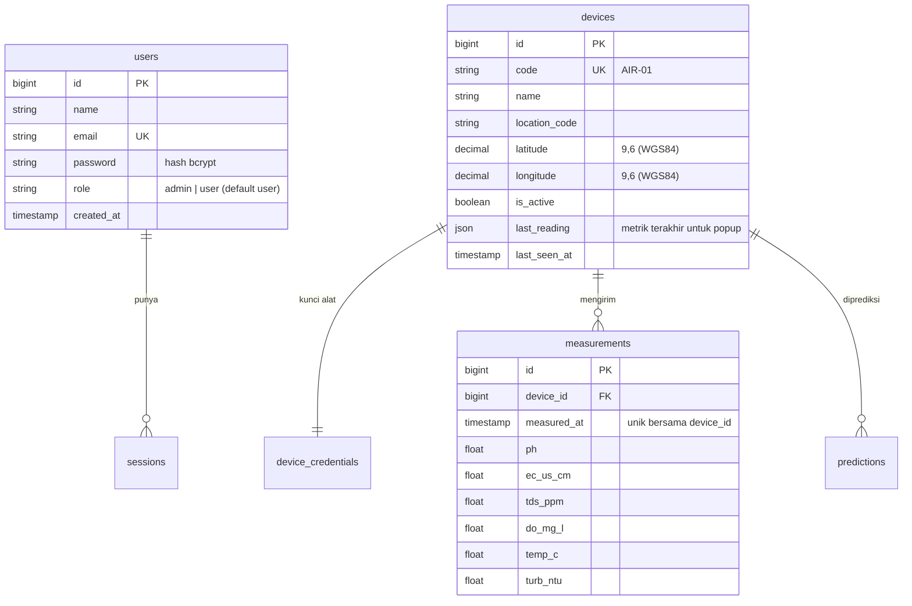

# Dashboard Saw-IT

Dashboard pemantauan kualitas air bertema **hijau-putih**, dibuat dengan mengadaptasi proyek `airtracking` (Laravel 13 + Leaflet + ESP32). Stack **tidak diganti**: referensi sudah berupa aplikasi Laravel lengkap (backend, admin, API, peta), jadi Saw-IT memakai **Laravel 13 / PHP 8.3+, Blade, Leaflet.js + OpenStreetMap, SQLite/MySQL/PostgreSQL**. Tailwind tidak dipakai karena CSS referensi sudah berbasis variabel warna; tema hijau cukup menimpa variabel di satu file.

## Yang berubah dari airtracking

| Kebutuhan | Sebelumnya | Sekarang |
|---|---|---|
| Login & Register | Hanya login admin | `/login` dan `/register` hijau-putih; pendaftar otomatis `role = user` |
| Role Admin | Panel `/admin/*` | Tetap, ditambah **`/admin/users`** (tambah/ubah peran/reset sandi/hapus akun) |
| Role User Publik | Tanpa login | Wajib login, **hanya baca**: `/` (dashboard) dan `/lokasi` (peta). URL admin dijawab 403 |
| Data JSON dashboard | `/api/public/*` terbuka | Pindah ke `routes/web.php` di balik `auth` (path sama, JS tidak diubah) |
| Peta | Leaflet + marker + popup | **Sudah ada**, dipertahankan: marker dari `latitude/longitude`, popup berisi nama, ID, kode lokasi, waktu, enam metrik udara/air dan status berwarna |
| Tema | Putih-biru | Putih-hijau (`public/css/sawit-theme.css`) |
| Endpoint alat | `POST /api/ingest` | Tidak berubah, firmware ESP32 tetap jalan |

## Skema database

Tabel `users` dan `devices` dipakai langsung. **`devices` berperan sebagai tabel `locations`**: satu baris = satu titik pemantauan dengan koordinatnya. Nama tabel tidak diganti agar firmware, API, dan relasi `measurements` tidak rusak. Bila dosen/klien mewajibkan nama `locations`, cukup `Schema::rename('devices','locations')` dan ubah `$table` di model `Device`.



Skema lengkap (credential, prediksi, baku mutu): `airtracking/docs/skema-database.md`.

## Struktur folder (bagian yang relevan)

```
airtracking/
├─ app/Http/
│  ├─ Controllers/
│  │  ├─ Auth/AuthController.php        ← BARU: login, register, logout
│  │  ├─ Admin/UserController.php       ← BARU: CRUD pengguna
│  │  ├─ Admin/DeviceController.php     CRUD alat + titik koordinat
│  │  ├─ Admin/{Limit,Wifi}Controller.php
│  │  └─ Api/{PublicController,IngestController}.php
│  └─ Middleware/EnsureAdmin.php        ← DIUBAH: user biasa → 403
├─ bootstrap/app.php                    ← DIUBAH: redirect tamu ke /login, alias 'admin'
├─ routes/
│  ├─ web.php                           ← DIUBAH: guest / auth / admin
│  └─ api.php                           ← DIUBAH: hanya /api/ingest + /api/health
├─ resources/views/
│  ├─ auth/{login,register}.blade.php   ← BARU
│  ├─ admin/users.blade.php             ← BARU
│  ├─ layouts/app.blade.php, partials/site-header.blade.php   ← DIUBAH (menu per peran)
│  └─ dashboard.blade.php, lokasi.blade.php                   peta Leaflet
├─ public/css/sawit-theme.css           ← BARU: palet hijau-putih
├─ public/js/{peta,lokasi,dashboard}.js inisialisasi peta + marker + popup
├─ tests/Feature/SawitAccessTest.php    ← BARU: uji akses tamu/user/admin
└─ tests/legacy-airtracking/            tes lama (mengasumsikan dashboard tanpa login)
```

## Pemasangan

Syarat: **PHP 8.3+** (dengan ekstensi `pdo_sqlite`, `mbstring`, `openssl`, `fileinfo`), **Composer**. Node.js/npm **tidak perlu**: tampilan memakai CSS di `public/`.

```bash
cd airtracking
setup.bat            # Windows
sh setup.sh          # Linux / macOS
php artisan serve    # buka http://127.0.0.1:8000 → diarahkan ke /login
```

Skrip `setup` membuat `.env`, memasang paket, membuat kunci aplikasi dan `database/database.sqlite`, menjalankan migrasi + seeder rentang normal, lalu menanyakan email dan sandi admin. Langkah manualnya:

```bash
copy .env.example .env            # Linux: cp
composer install
php artisan key:generate
type nul > database\database.sqlite   # Linux: touch database/database.sqlite
php artisan migrate --seed
php artisan airtracking:make-admin admin@contoh.com --name=Admin
```

Data contoh opsional: `php artisan db:seed --class=DemoSeeder`. Menjalankan tes: `php artisan test`. Memasang ke salinan `airtracking` lain: `sh overlay-src/install.sh /path/ke/airtracking`.

### Bila masih galat

| Pesan | Penyebab dan perbaikan |
|---|---|
| `No application encryption key has been specified` | `php artisan key:generate` belum dijalankan |
| `Database file ... does not exist` | Buat berkas kosong `database/database.sqlite` |
| `could not find driver` | Aktifkan `extension=pdo_sqlite` dan `extension=sqlite3` di `php.ini` |
| `Please provide a valid cache path` / `Unable to create ... storage` | Folder `storage/` dan `bootstrap/cache` harus ada dan bisa ditulis |
| `Your PHP version ... does not satisfy` | Pakai PHP 8.3 atau lebih baru |
| `Table 'sessions' doesn't exist` | `php artisan migrate` belum dijalankan |
| Login berhasil tapi kembali ke halaman login | `APP_URL` di `.env` berbeda dengan alamat yang dibuka (mis. `localhost` vs `127.0.0.1`); samakan, lalu `php artisan config:clear` |

## Kode kunci

**Autentikasi** (`Auth/AuthController@register`): peran tidak pernah dibaca dari request.

```php
User::create(['name' => $v['name'], 'email' => strtolower($v['email']),
              'password' => $v['password'], 'role' => 'user']);   // cast 'hashed' di model
```

**RBAC** (`routes/web.php`): tiga lapis, `guest` → `auth` (baca) → `auth + admin` (CRUD).

```php
Route::middleware('auth')->group(function () { /* '/', '/lokasi', /api/public/* */ });
Route::prefix('admin')->middleware(['auth', 'admin'])->group(function () { /* CRUD */ });
```

**Peta** (`public/js/peta.js`, `lokasi.js`): `PETA.create('peta')` membuat peta OSM terpusat di Malang; tiap alat ber-koordinat jadi `L.marker([lat, lng])` dengan ikon berwarna sesuai status (hijau normal, kuning waspada, merah perlu perhatian, abu belum ada data) dan `bindPopup()` berisi nama, ID, kode lokasi, waktu terakhir, enam metrik, dan tautan detail. Data diperbarui otomatis tiap 60 detik. Admin menandai koordinat di `/admin/lokasi` (klik/geser penanda atau ketik lat-lng).

## Catatan

- **Belum dijalankan**: lingkungan tempat paket ini disusun tidak punya PHP, jadi kode tidak sempat dieksekusi dan `php artisan test` belum dicoba. Jalankan langkah pemasangan di atas; bila ada galat, kirim pesannya.
- Tes lama dipindah ke `tests/legacy-airtracking/` karena menguji dashboard tanpa login. Tulis ulang bila masih dibutuhkan.
- Peta memakai tile OpenStreetMap (gratis, tanpa API key); untuk trafik besar pakai penyedia tile berbayar atau Mapbox.
- Verifikasi email dan lupa sandi belum ada; tambahkan bila akun publik dibuka luas.
- Teks "AirTracking" di `resources/views` diganti "Saw-IT" oleh `install.sh`; firmware, nama perintah artisan, dan dokumen README lama tidak diubah.
