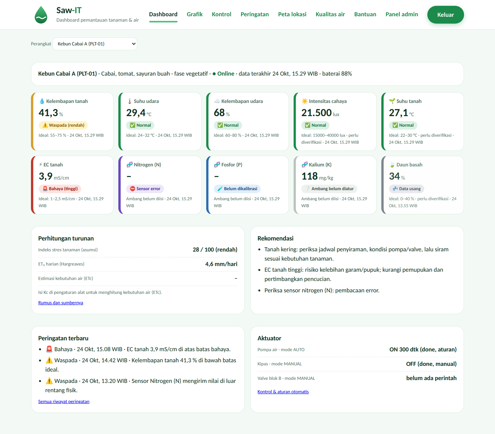
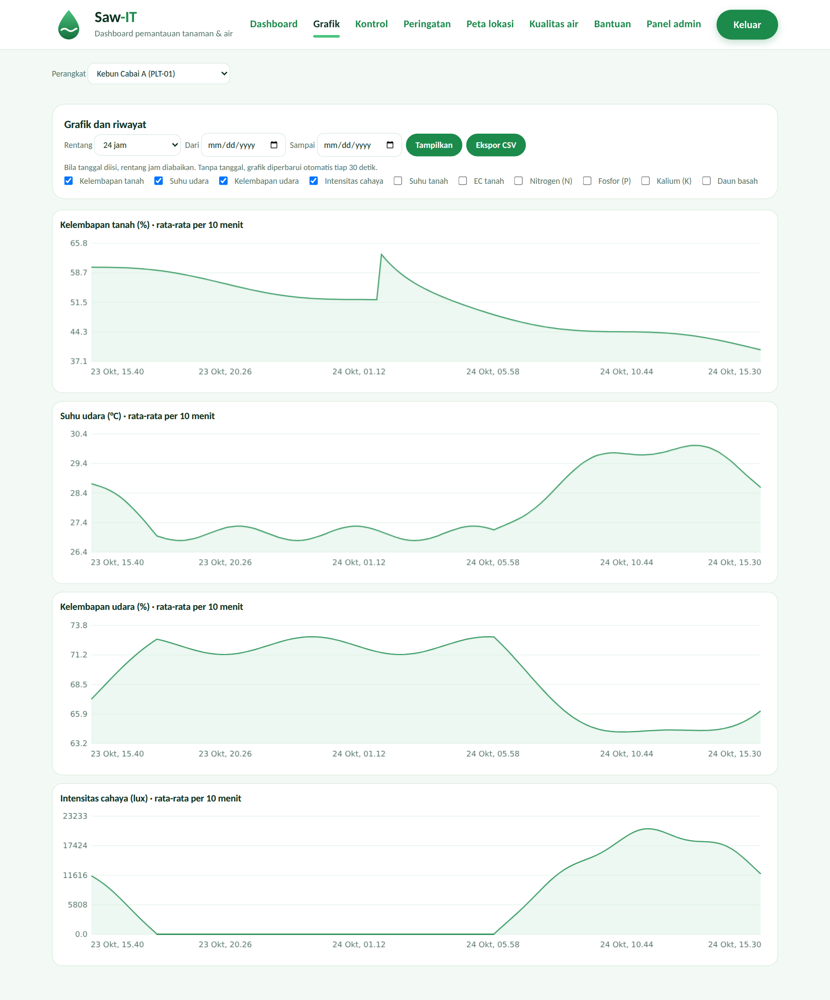
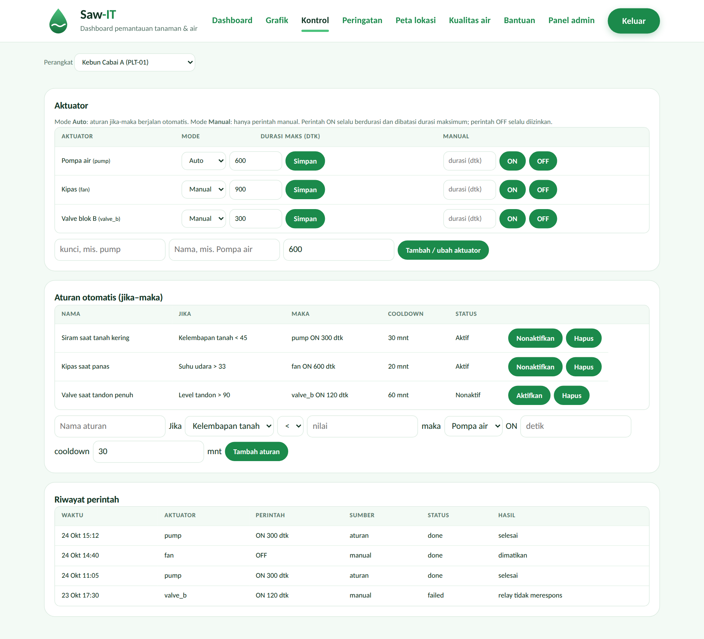
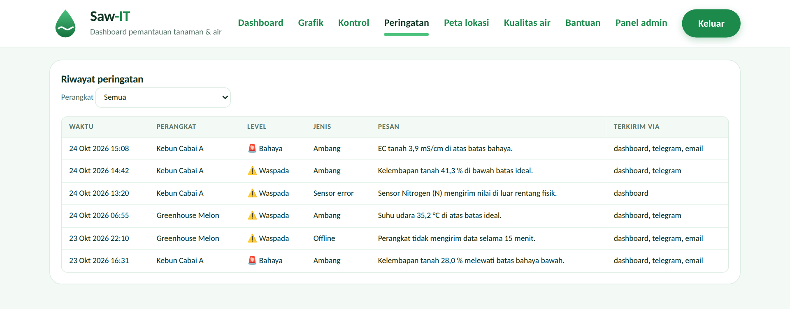
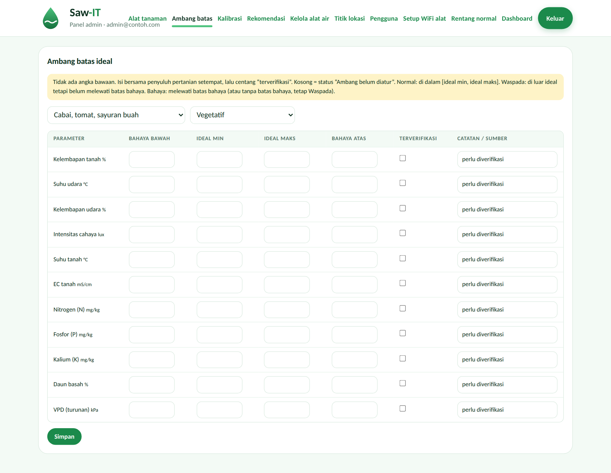
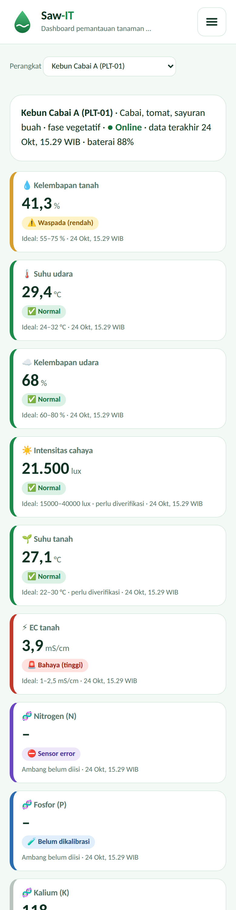

# 🌿 Saw-IT

Dashboard web pemantau tanaman berbasis IoT, dibangun di atas **Laravel 13**. Perangkat di lahan mengirim data sensor lewat HTTP (JSON); dashboard menampilkan status, grafik, peringatan, dan mengendalikan aktuator (pompa, kipas, lampu, valve) lewat aturan otomatis atau perintah manual.




> **Tentang tangkapan layar.** Gambar di README ini dirender dengan Chromium dari CSS dan JavaScript asli proyek, memakai **data contoh dan respons API yang disimulasikan**, bukan dari instalasi yang sedang berjalan. Font Outfit tidak tersedia saat render, jadi huruf pada gambar memakai font cadangan. Angka ambang di gambar hanya ilustrasi, **bukan rekomendasi agronomi**. Ganti dengan tangkapan layar dari instalasi Anda setelah semuanya berjalan.

> **Status.** Kode modul tanaman belum pernah dijalankan di lingkungan PHP penyusunnya. Jalankan `php artisan test` setelah pemasangan dan laporkan galat bila ada.

## Daftar isi
- [Fitur](#fitur)
- [Tampilan](#tampilan)
- [Arsitektur](#arsitektur)
- [Instalasi](#instalasi)
- [Alur penggunaan pertama](#alur-penggunaan-pertama)
- [Kontrak perangkat (API)](#kontrak-perangkat-api)
- [Konfigurasi](#konfigurasi)
- [Rumus dan asumsi](#rumus-dan-asumsi)
- [Pengujian](#pengujian)
- [Struktur folder](#struktur-folder)
- [Batasan](#batasan)

## Fitur

| # | Fitur | Ringkasan |
|---|---|---|
| 1 | **Ambang batas ideal** | Per komoditas, parameter, dan fase tumbuh (semai/vegetatif/generatif/panen), dapat diubah admin. Seeder hanya membuat struktur **kosong** bertanda "perlu diverifikasi". |
| 2 | **Status visual** | Kartu per sensor: Normal, Waspada, Bahaya, Sensor error, Data usang, Belum dikalibrasi. Selalu ada ikon dan teks, tidak hanya warna. |
| 3 | **Notifikasi** | Alert di dashboard, Telegram, dan email lewat queue, dengan cooldown anti-spam dan log riwayat. |
| 4 | **Kontrol otomatis** | Aturan jika-maka, mode Auto/Manual, durasi maksimum. Perangkat mengambil perintah lewat polling dan melaporkan hasilnya. |
| 5 | **Grafik dan riwayat** | Auto-refresh, filter 6 jam hingga 30 hari atau rentang tanggal, ekspor CSV. |
| 6 | **Perhitungan turunan** | VPD, estimasi kebutuhan air (ET₀ × Kc), indeks stres. Rumus dan sumbernya tertulis di kode dan halaman Bantuan. |
| 7 | **Rekomendasi** | Saran tindakan berbahasa Indonesia berbasis aturan yang dapat diedit. |
| 8 | **Kalibrasi sensor** | Kalibrasi dua titik (kering/basah atau larutan buffer) per sensor. |
| 9 | **Ketahanan** | Ingest idempoten, batch data tertunda, timestamp perangkat dan server, deteksi sensor error dan perangkat offline. |

Komoditas yang disiapkan: padi, cabai/tomat/sayuran buah, hidroponik, jagung/kedelai/palawija, kopi/kakao/perkebunan, greenhouse, dan jamur, masing-masing dengan sensor tambahan yang relevan (lihat `config/plant.php`). Modul kualitas air bawaan proyek ([kualitas air](README-SAWIT.md)) tetap tersedia di `/air`.

## Tampilan

### Dashboard
Kartu status diperbarui otomatis tiap 10 detik. Di bawahnya: perhitungan turunan, rekomendasi, peringatan terbaru, dan status aktuator.


### Grafik dan riwayat

*Pratinjau memakai pengganti kanvas sederhana karena Chart.js dimuat dari CDN; di aplikasi sungguhan grafik digambar oleh Chart.js 4.*

### Kontrol aktuator dan aturan otomatis


### Riwayat peringatan


### Admin: ambang batas
Kondisi awal setelah `migrate --seed`: semua nilai kosong dan bertanda "perlu diverifikasi".



### Tampilan di HP


## Arsitektur

```
 Perangkat (ESP32 dkk.)                         Server Laravel
 ┌──────────────────┐  POST /api/plant/ingest  ┌───────────────────────────────┐
 │ sensor + aktuator│ ───────────────────────► │ DeviceAuth → PlantIngestor    │
 │                  │                          │   kalibrasi → validasi fisik  │
 │                  │  GET  /api/plant/commands│   simpan idempoten            │
 │                  │ ◄─────────────────────── │   AlertEngine → Queue → TG/Mail│
 │                  │  POST …/result           │   ControlEngine → perintah    │
 └──────────────────┘ ───────────────────────► │ Scheduler: plant:watch (1 mnt)│
                                               └──────────────┬────────────────┘
                                                              │ JSON + Blade
                                                      Dashboard web (login)
```

- **Backend:** Laravel 13, SQLite/MySQL/PostgreSQL, queue `database`, scheduler.
- **Frontend:** Blade, CSS biasa, JavaScript tanpa framework, Chart.js dari CDN (tanpa Node/npm).
- **Autentikasi:** sesi untuk pengguna (peran `admin` dan `user`, user hanya baca); kunci per perangkat (disimpan sebagai hash SHA-256) untuk API.
- **Tabel utama:** `devices` (dipakai bersama modul air), `plant_readings`, `plant_thresholds`, `plant_calibrations`, `plant_alerts`, `plant_actuators`, `plant_control_rules`, `plant_commands`, `plant_recommendation_rules`.

## Instalasi

Kebutuhan: **PHP 8.3+** (ekstensi `pdo_sqlite`/`pdo_mysql`, `mbstring`, `openssl`, `fileinfo`) dan **Composer**.

```bash
git clone <url-repo-anda> && cd <nama-repo>/saw-it
cp .env.example .env
composer install
php artisan key:generate
touch database/database.sqlite            # atau atur DB_* di .env untuk MySQL/PostgreSQL
php artisan migrate --seed                # struktur ambang (KOSONG) + rekomendasi awal
php artisan saw-it:make-admin admin@contoh.com --name=Admin
php artisan serve                         # http://127.0.0.1:8000
```

Proses latar belakang (wajib untuk notifikasi dan deteksi offline):

```bash
php artisan queue:work
# cron, tiap menit:
* * * * * cd /path/ke/saw-it/saw-it && php artisan schedule:run >> /dev/null 2>&1
```

Skrip `setup.sh` / `setup.bat` mengotomatiskan langkah dasar. Jika muncul galat, lihat tabel pemecahan masalah di [README-SAWIT.md](README-SAWIT.md).

## Alur penggunaan pertama

1. **Admin → Alat tanaman**: tambah perangkat (komoditas, fase, Kc, batas offline). Salin **kunci perangkat**, hanya tampil sekali.
2. **Admin → Ambang batas**: isi nilai ideal dan batas bahaya bersama penyuluh pertanian setempat, lalu centang "terverifikasi".
3. **Admin → Kalibrasi**: kalibrasi sensor kelembapan tanah (wajib), serta pH/EC bila dipakai.
4. **Kontrol**: daftarkan aktuator, atur batas durasi, lalu buat aturan jika-maka dan pilih mode Auto/Manual.
5. **Konfigurasi notifikasi** di `.env` (lihat di bawah), lalu pastikan `queue:work` berjalan.
6. Isi koordinat alat di menu **Titik lokasi** agar ET₀ dapat dihitung.

## Kontrak perangkat (API)

Autentikasi: header `X-Device-Id` dan `X-Device-Key` (atau field `id` dan `key` di body).

**Kirim data**: `POST /api/plant/ingest`

```json
{
  "ts": "2026-10-24T08:30:00Z",
  "fw": "1.0", "bat": 88,
  "data": { "soil_moisture": 512, "air_temp": 28.1, "air_rh": 71, "light": 18000, "soil_temp": 26.4 }
}
```

Data tertunda dikirim sekaligus: `{"records":[{"ts":"…","data":{…}}, …]}` (maksimal 500). Respons: `{"ok":true,"saved":n,"duplicates":n,"ignored":n}`. Mengirim ulang paket yang sama aman: duplikat ditolak. Nilai `null` atau di luar rentang fisik sensor disimpan sebagai **sensor error**.

**Ambil perintah**: `GET /api/plant/commands`

```json
{ "server_time": "2026-10-24T08:31:00Z",
  "commands": [ { "id": 7, "actuator": "pump", "action": "on", "duration_sec": 300 } ] }
```

**Lapor hasil**: `POST /api/plant/commands/{id}/result` dengan `{"status":"done","message":"…"}` (atau `"failed"`).

Perangkat wajib mematikan aktuator sendiri setelah `duration_sec`. Contoh uji dengan curl:

```bash
curl -X POST http://127.0.0.1:8000/api/plant/ingest \
  -H "X-Device-Id: PLT-01" -H "X-Device-Key: <kunci>" -H "Content-Type: application/json" \
  -d '{"data":{"air_temp":28.1,"air_rh":71}}'
```

Kunci sensor yang dikenali: `soil_moisture, air_temp, air_rh, light, soil_temp, water_level, soil_ph, rain, soil_ec, soil_n, soil_p, soil_k, leaf_wet, water_ph, water_ec, water_temp, tank_level, flow, co2, uv`. VPD dihitung server.

## Konfigurasi

Tambahkan ke `.env`:

```ini
APP_TIMEZONE=UTC                 # jangan diubah; tampilan memakai WIB
QUEUE_CONNECTION=database
PLANT_ALERT_COOLDOWN_MIN=30
TELEGRAM_BOT_TOKEN=
TELEGRAM_CHAT_ID=
PLANT_ALERT_MAIL=                # butuh pengaturan MAIL_* yang valid
```

Daftar sensor, batas fisik, komoditas, dan fase ada di `config/plant.php`. Batas fisik adalah batas umum sensor; sesuaikan dengan datasheet sensor Anda.

## Rumus dan asumsi

- **VPD** = es × (1 − RH/100), es = 0,6108·exp(17,27·T/(T+237,3)) kPa (Tetens; FAO-56 pers. 11).
- **ET₀** Hargreaves-Samani = 0,0023·(Tmean+17,8)·√(Tmax−Tmin)·Ra (FAO-56 pers. 52). Perkiraan kasar; butuh koordinat alat.
- **Kebutuhan air** ETc = Kc × ET₀ (L/m²/hari). **Kc tidak punya nilai bawaan**; isi dari rujukan FAO-56 atau penyuluh.
- **Indeks stres** adalah **asumsi** (tidak ada rumus baku): rata-rata penalti status sensor (Normal 0, Waspada 0,5, Bahaya 1) × 100.
- **Ambang batas tidak diisi** secara sengaja. Tanpa ambang, kartu berstatus "Ambang belum diatur" dan tidak ada alert ambang.
- Data yang lebih tua dari 10 menit (paket tertunda) disimpan tetapi **tidak** memicu alert atau kontrol.

Penjelasan lengkap juga tersedia di halaman **Bantuan** dalam aplikasi.

## Pengujian

```bash
php artisan test
```

`tests/Feature/PlantTest.php` mencakup evaluasi status, VPD dan ET₀, autentikasi perangkat, ingest idempoten, sensor error, kalibrasi, cooldown alert, dan alur perintah aktuator. Telegram dan email tidak diuji otomatis karena butuh kredensial Anda.

## Struktur folder

```
saw-it/
├─ saw-it/                         aplikasi Laravel
│  ├─ app/Services/Plant/          Status, Derived, PlantIngestor, AlertEngine, ControlEngine, PlantSnapshot
│  ├─ app/Http/Controllers/        Api/Plant*, Plant/*, Admin/Plant*, Threshold*, Calibration*, Recommendation*
│  ├─ app/Jobs/SendAlertNotification.php
│  ├─ app/Console/Commands/PlantWatch.php
│  ├─ config/plant.php             sensor, komoditas, fase
│  ├─ database/                    migrasi + PlantSeeder
│  ├─ resources/views/plant/       dashboard, grafik, kontrol, peringatan, bantuan
│  └─ tests/Feature/PlantTest.php
├─ saw-it-firmware/                firmware ESP32 untuk modul air (tidak dipakai modul tanaman)
├─ docs/screenshots/               gambar README
├─ README-TANAM.md                 catatan teknis modul tanaman
└─ README-SAWIT.md                 catatan adaptasi Saw-IT (login, peran, peta)
```

## Batasan

- **Firmware tanaman tidak termasuk.** Perangkat harus mengikuti kontrak API di atas. Firmware ESP32 di folder ini hanya untuk modul kualitas air.
- Dashboard air (`/api/public/devices`) masih menampilkan semua baris `devices`, termasuk perangkat tanaman tanpa data air.
- Verifikasi email dan lupa sandi belum ada.
- Grafik riwayat dirata-ratakan di PHP; untuk data sangat besar, pertimbangkan agregasi di database.

## Lisensi

MIT (lihat `composer.json`).
