# Panduan tampilan web AirTracking

Dokumen ini menjelaskan apa yang tampil di setiap halaman, apa arti warna dan label, serta bagaimana tampilan menyesuaikan ukuran layar. Untuk instalasi dan API, lihat [`README.md`](../README.md).

Semua halaman memakai gaya bertema **putih-biru**, berbahasa Indonesia, dan berbagi satu header.

| Halaman | Alamat | Akses |
|---|---|---|
| [Dashboard](#1-dashboard-publik) | `/` | Publik |
| [Peta lokasi](#2-peta-lokasi) | `/lokasi` | Publik |
| [Login admin](#3-login-admin) | `/admin/login` | Publik (form) |
| [Kelola alat](#4-kelola-alat) | `/admin/devices` | Admin |
| [Titik lokasi](#5-titik-lokasi) | `/admin/lokasi` | Admin |
| [Setup WiFi alat](#6-setup-wifi-alat) | `/admin/wifi` | Admin |
| [Rentang normal](#7-rentang-normal) | `/admin/limits` | Admin |
| [Setup di alat (Mode AP)](#8-setup-di-alat-mode-ap) | `192.168.4.1` | Lewat WiFi alat |

## Gaya visual

| Unsur | Nilai |
|---|---|
| Font | Outfit (Google Fonts, bobot 400 sampai 700), cadangan `system-ui` |
| Latar halaman | `#F4F9FF` (biru sangat muda) |
| Kartu dan panel | Putih, garis `#E3ECF7`, sudut membulat 20 px |
| Teks | `#0F2A4A` (utama), `#6B84A3` (keterangan) |
| Biru utama | `#1E6FD9` (tombol, angka ringkasan, garis grafik) |
| Lebar isi | Maksimal 1152 px, di tengah |

### Arti warna status

| Status | Label | Warna | Kapan |
|---|---|---|---|
| Normal | ✓ Normal | Hijau (`#1F7A4D` di latar `#DCF1E5`) | Nilai di dalam rentang normal |
| Waspada | ! Waspada | Kuning tua (`#9A6700` di latar `#FBEFC8`) | Di dalam rentang, tetapi kurang dari 10% lebar rentang dari batas |
| Di luar rentang | ▲ Di luar rentang | Merah (`#B3261E` di latar `#FBDEDB`) | Nilai melewati batas bawah atau batas atas |
| Belum ada data | Belum ada data | Abu-abu | Alat belum pernah mengirim data |

Status selalu disertai simbol dan teks, bukan warna saja.

### Ukuran layar

- **Header**: di layar 1000 px ke bawah, menu berubah menjadi tombol burger (☰) yang membuka daftar menu penuh. Di 560 px ke bawah, logo dan subjudul mengecil.
- **Grafik dan prediksi**: dua kolom (grafik lebih lebar), menjadi satu kolom di 860 px ke bawah.
- **Peta dan daftar titik**: dua kolom, menjadi satu kolom di 860 px ke bawah (tinggi peta 560 px menjadi 420 px).
- **Kartu ringkasan, daftar alat, kartu parameter, dan strip status**: grid yang menyesuaikan jumlah kolom otomatis.
- Tabel lebar bergulir ke samping di dalam kotaknya sendiri, jadi halaman tidak ikut bergeser.
- Animasi dimatikan bila pengguna memilih "kurangi gerakan" di perangkatnya.

| Menu di HP | Dashboard di HP |
|---|---|
| 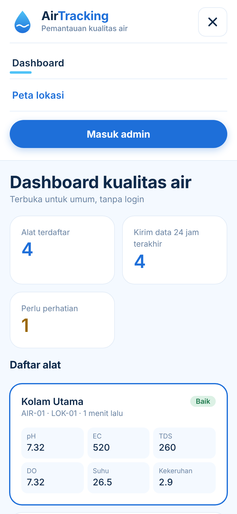 |  |

---

## Header (semua halaman)

Header menempel di bagian atas saat halaman digulir.

- **Kiri**: logo tetes air biru, tulisan **Air**Tracking (kata "Tracking" berwarna biru), dan subjudul.
  - Pengunjung: "Pemantauan kualitas air".
  - Admin di halaman admin: "Panel admin · email admin".
- **Menu pengunjung**: Dashboard, Peta lokasi, dan tombol **Masuk admin**.
- **Menu admin** (di halaman `/admin/*`): Kelola alat, Titik lokasi, Setup WiFi alat, Rentang normal, Dashboard publik, dan tombol **Keluar**.
- Admin yang sedang melihat halaman publik melihat tombol **Panel admin** untuk kembali ke panel.
- Menu aktif ditandai garis biru muda di bawah tulisannya.

---

## 1. Dashboard publik

Alamat `/`. Terbuka untuk umum tanpa login. Data dimuat dari API publik dan **diperbarui otomatis setiap 15 detik**.

### Bagian atas

- Judul **Dashboard kualitas air** dengan keterangan "Terbuka untuk umum, tanpa login".
- Bila server tidak terjangkau, muncul lencana putus-putus **"Data contoh, server belum terhubung"** dan halaman memakai data contoh bawaan. Tombol unduh CSV disembunyikan pada mode ini.

### Kartu ringkasan

| Kartu | Isi |
|---|---|
| Alat terdaftar | Jumlah alat aktif |
| Kirim data 24 jam terakhir | Jumlah alat yang mengirim data dalam 24 jam terakhir |
| Perlu perhatian | Jumlah alat dengan minimal satu parameter di luar rentang. Angkanya berubah menjadi kuning bila lebih dari nol |

### Daftar alat

Satu kartu per alat:

- Nama alat dan label status di kanan atas: **Baik**, **Perlu perhatian**, atau **Belum ada data**.
- Baris keterangan: `ID alat · kode lokasi · waktu terakhir kirim` (mis. "AIR-03 · LOK-03 · 1 jam lalu").
- Enam nilai terbaru dalam kotak kecil: pH, EC, TDS, DO, Suhu, Kekeruhan. Nilai yang waspada atau di luar rentang diberi warna kuning atau merah.
- Mengklik kartu memilih alat tersebut. Kartu terpilih diberi bingkai biru, dan alamat halaman berubah menjadi `/#ID-ALAT` sehingga bisa dibagikan sebagai tautan langsung. Tanpa tautan, alat pertama yang dipilih.

### Detail alat

Muncul di bawah daftar untuk alat yang dipilih.

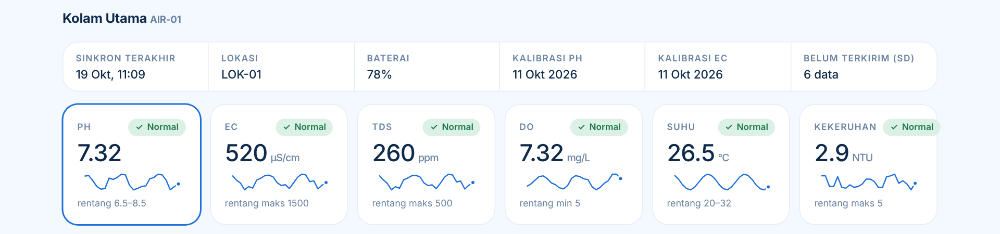

**Strip status alat** (enam kolom): Sinkron terakhir, Lokasi, Baterai (%), Kalibrasi pH, Kalibrasi EC, dan Belum terkirim (SD) dalam jumlah data. Nilai kosong ditampilkan sebagai "–".

**Kartu parameter** (enam kartu), masing-masing berisi:

- nama parameter dan label status (✓ Normal, ! Waspada, atau ▲ Di luar rentang),
- nilai terbaru dengan satuannya,
- **sparkline**, yaitu garis kecil dari 24 pengukuran terakhir dengan titik biru di ujungnya,
- keterangan rentang normal, mis. "rentang 6.5–8.5", "maks 1500", atau "min 5".

Mengklik kartu parameter mengganti grafik tren di bawahnya.

### Grafik tren dan prediksi

**Tren parameter**

- Garis biru nilai pengukuran dengan pilihan rentang waktu **7 hari**, **14 hari**, dan **30 hari** (tab).
- **Pita hijau** menandai rentang normal. **Titik merah** menandai pengukuran di luar rentang. Titik biru besar menandai pengukuran terakhir.
- Arahkan kursor atau jari ke grafik untuk melihat garis bidik dan tooltip berisi waktu, nilai, dan status bila tidak normal.
- Bila data kurang dari 2 titik, grafik diganti pesan "Data riwayat belum cukup untuk grafik (minimal 2 data)".

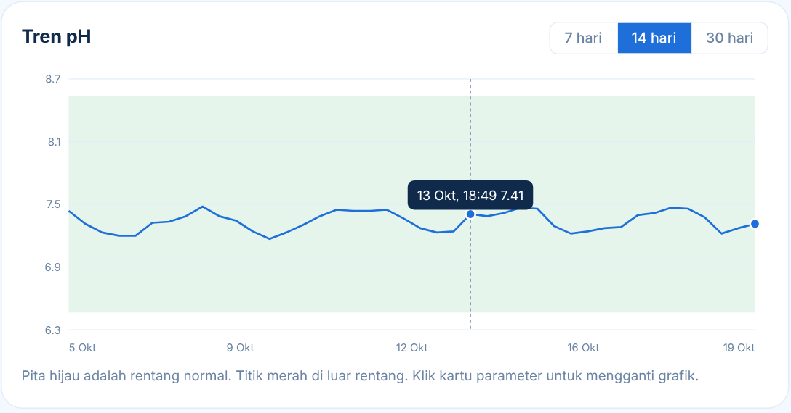

**Prediksi kualitas air**

- Label besar hasil prediksi (**Aman**, **Waspada**, atau **Tercemar**) dan tiga batang probabilitas dalam persen.
- Keterangan dasar data (waktu pengukuran) dan versi model.
- Tombol **Jalankan prediksi** untuk mengambil ulang prediksi.
- Catatan di panel: saat ini berupa aturan sederhana sebagai contoh, bukan model machine learning.

### Riwayat, rentang normal, dan API

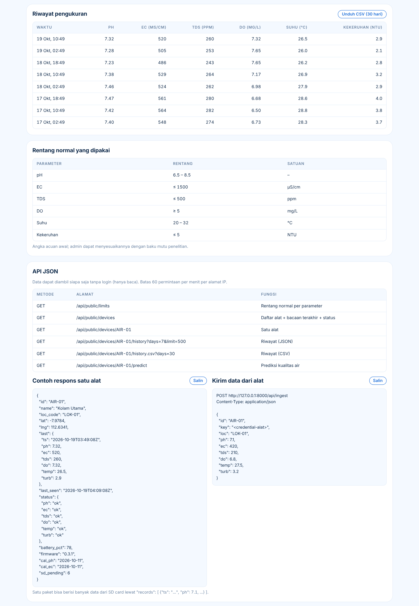

- **Riwayat pengukuran**: tabel 8 pengukuran terbaru (terbaru di atas) dengan satuan di judul kolom. Nilai di luar rentang ditebalkan merah. Tombol **Unduh CSV (30 hari)** mengunduh riwayat alat terpilih.
- **Rentang normal yang dipakai**: tabel parameter, rentang (`6.5 – 8.5`, `≤ 1500`, `≥ 5`), dan satuan.
- **API JSON**: tabel endpoint publik, contoh respons satu alat, dan contoh pengiriman data dari alat. Kedua contoh punya tombol **Salin**, dan alamat serta ID alat di dalamnya mengikuti alat yang dipilih.

---

## 2. Peta lokasi

Alamat `/lokasi`. Terbuka untuk umum. Memakai Leaflet dan peta OpenStreetMap, sehingga butuh koneksi internet di browser.

- Judul **Peta lokasi alat** dengan keterangan "Kota Malang dan sekitarnya".
- Tiga kartu ringkasan: **Titik di peta**, **Belum ditandai** (alat tanpa koordinat), dan **Perlu perhatian**.
- **Peta** dengan satu titik bulat per alat. Warna titik:

  | Warna | Arti |
  |---|---|
  | Hijau | Normal |
  | Kuning | Waspada (ada parameter yang mendekati batas) |
  | Merah | Perlu perhatian (ada parameter di luar rentang) |
  | Abu-abu | Belum ada data |

- Di bawah peta ada keterangan warna dan tombol **Pusatkan ke Malang**.
- Mengklik titik membuka **jendela info**: nama, `ID · kode lokasi · waktu terakhir kirim`, enam nilai terbaru, koordinat, dan tautan **Lihat detail →** yang membuka dashboard untuk alat itu.
- Di samping peta ada daftar **Titik alat** dengan label status. Mengklik satu alat menggeser dan memperbesar peta ke titiknya lalu membuka jendela infonya.
- Alat yang belum punya koordinat tidak muncul di peta. ID-nya dicantumkan di bawah daftar, dan bila semua alat belum bertanda, tampil pesan agar admin menandai titik lewat menu **Titik lokasi**.
- Saat dibuka pertama kali, peta menyesuaikan tampilan agar semua titik terlihat. Data diperbarui otomatis setiap 60 detik.
- Bila data gagal dimuat, tampil pesan galat berwarna merah di atas peta.

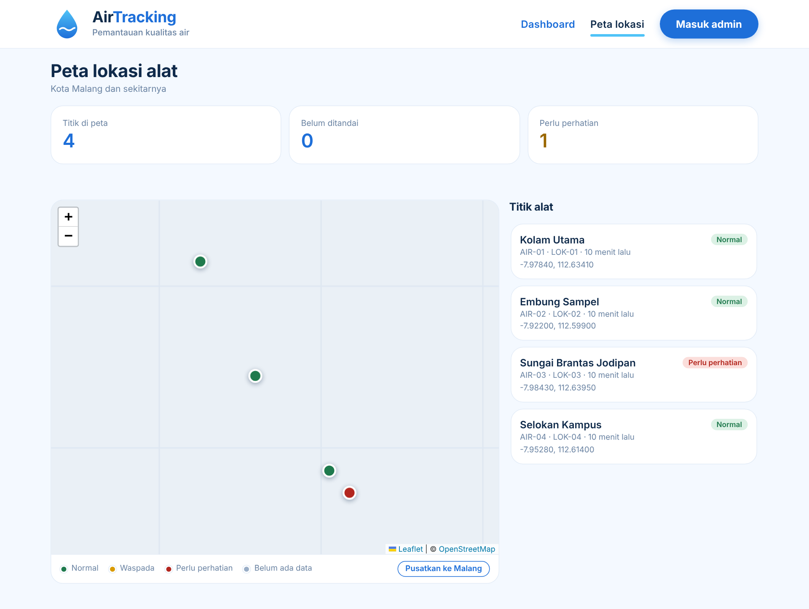

Jendela info setelah satu alat dipilih dari daftar:

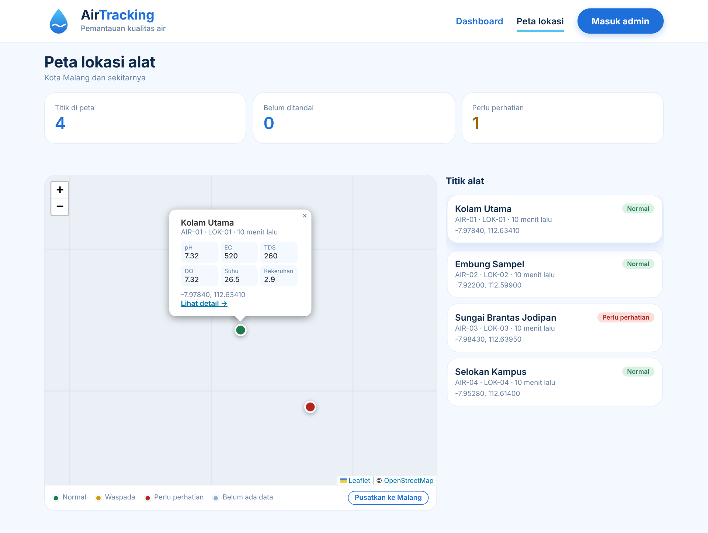

> Pada screenshot ini latar peta tampil polos karena tile OpenStreetMap tidak dimuat saat gambar dibuat. Di browser dengan internet, peta menampilkan jalan dan nama tempat.

---

## 3. Login admin

Alamat `/admin/login`. Kartu di tengah halaman berisi judul **AirTracking**, penjelasan "Masuk khusus admin untuk mengelola alat. Dashboard publik tidak memerlukan login.", kolom Email dan Kata sandi, tombol **Masuk**, dan tautan "‹ Kembali ke dashboard publik".

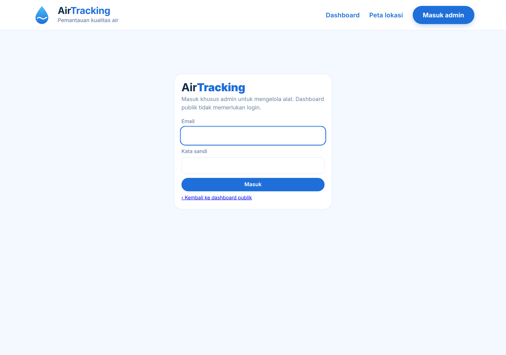

- Akun yang bukan admin ditolak dengan pesan "Email atau kata sandi salah, atau akun bukan admin."
- Setelah 5 kali gagal, tampil "Terlalu banyak percobaan. Coba lagi dalam N detik."
- Admin yang sudah masuk dan membuka halaman ini langsung diarahkan ke Kelola alat.

---

## 4. Kelola alat

Alamat `/admin/devices`.

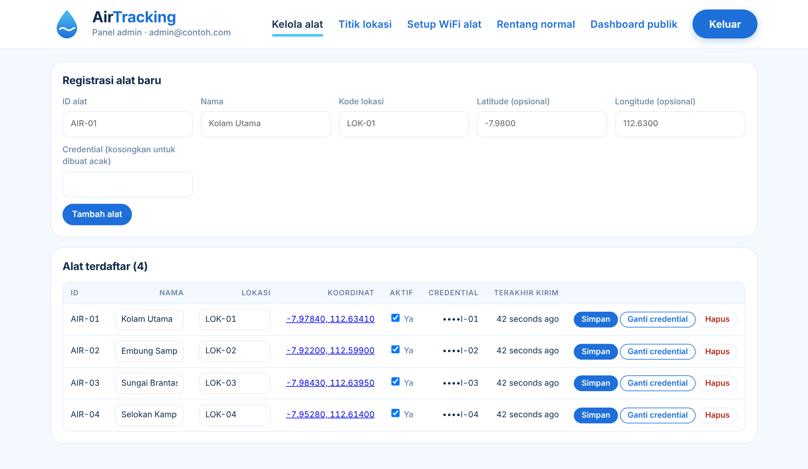

- **Kotak credential** (latar kuning): muncul sekali setelah alat dibuat atau credential diganti, berisi credential asli dengan tombol **Salin**. Credential **tidak bisa dilihat lagi** setelah halaman ditutup; bila hilang, gunakan "Ganti credential".
- **Registrasi alat baru**: ID alat (2 sampai 32 karakter huruf, angka, `-`, atau `_`), Nama, Kode lokasi, Latitude dan Longitude (opsional, harus diisi berpasangan), dan Credential (kosongkan untuk dibuat acak 24 karakter, minimal 8 karakter bila diisi).
- **Alat terdaftar**: tabel dengan kolom ID, Nama (dapat diubah langsung), Lokasi (dapat diubah langsung), Koordinat (tautan ke halaman Titik lokasi, atau "Tandai" bila belum ada), kotak centang Aktif, Credential (hanya `••••` dan 4 karakter terakhir), dan waktu terakhir kirim.
- Tombol per baris: **Simpan**, **Ganti credential** (dengan konfirmasi, alat harus disetel ulang), dan **Hapus** (dengan konfirmasi, riwayat data alat ikut terhapus).
- Alat yang tidak dicentang Aktif ditolak saat mengirim data dan tidak tampil di dashboard publik.

---

## 5. Titik lokasi

Alamat `/admin/lokasi`. Tata letak mirip peta publik, dengan formulir di sisi kanan.

- Pilih alat pada daftar, lalu **klik peta** atau **geser penanda** untuk menaruh titik. Koordinat juga bisa diketik di kolom Latitude dan Longitude (koma desimal diterima).
- Penanda alat yang sedang diatur berwarna biru, alat lain abu-abu. Mengklik penanda alat lain memilih alat itu.
- Teks petunjuk di bawah kolom koordinat: "Klik peta untuk menaruh titik.", "Titik siap disimpan.", atau peringatan kuning bila titik di luar area Malang dan sekitarnya.
- Tombol **Simpan titik** baru aktif bila koordinat valid.

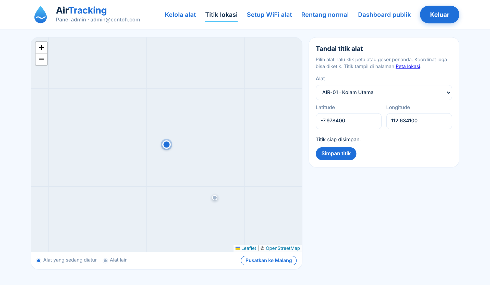
- Dari tabel Kelola alat, tautan koordinat membuka halaman ini dengan alat yang sudah terpilih.

---

## 6. Setup WiFi alat

Alamat `/admin/wifi`. Halaman panduan; WiFi alat sendiri diatur lewat halaman yang dibuka alat saat berada di mode AP.

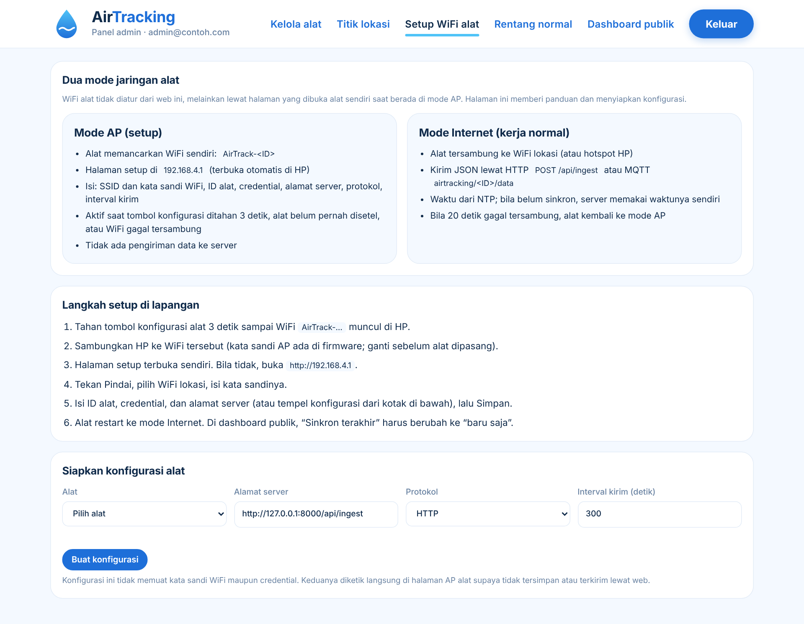

- **Dua mode jaringan alat**: kartu **Mode AP (setup)** dan **Mode Internet (kerja normal)** berdampingan.
- **Langkah setup di lapangan**: enam langkah bernomor, dari menahan tombol konfigurasi 3 detik sampai alat tersambung.
- **Siapkan konfigurasi alat**: pilih alat, alamat server, protokol (HTTP atau MQTT), dan interval kirim (detik, minimal 10), lalu **Buat konfigurasi**. Hasilnya berupa JSON yang bisa disalin. Konfigurasi ini sengaja tidak memuat kata sandi WiFi maupun credential.

---

## 7. Rentang normal

Alamat `/admin/limits`. Tabel semua parameter dengan kolom Parameter, Satuan, Batas bawah (dapat diubah), Batas atas (dapat diubah), dan Waspada dekat (batas yang memicu status Waspada).

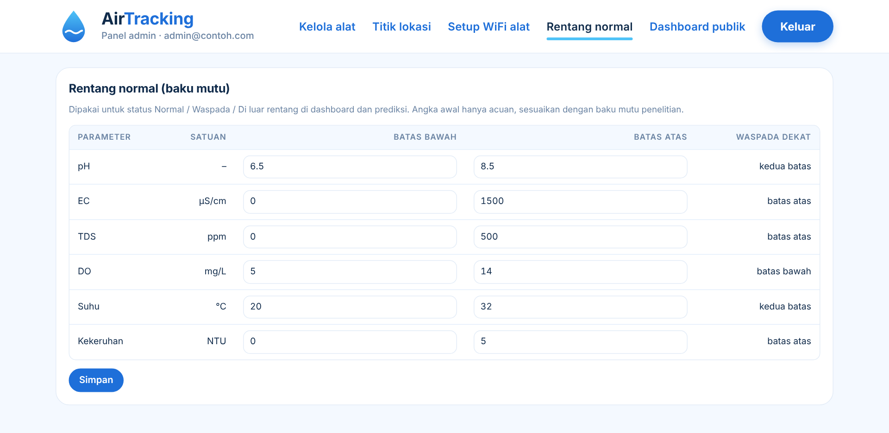

- Batas atas harus lebih besar dari batas bawah, bila tidak tampil pesan galat dan perubahan tidak disimpan.
- Perubahan berlaku untuk status di dashboard, peta, dan prediksi.
- Angka awal hanya acuan; sesuaikan dengan baku mutu yang dipakai.

---

## 8. Setup di alat (Mode AP)

Alamat `http://192.168.4.1`, dilayani oleh ESP32 controller saat **switch AP ON** dan HP tersambung ke WiFi `AirTrack-<ID>`. Halaman ini tidak berada di server Laravel dan tidak butuh internet. Satu halaman mengatur dua ESP32: perintah untuk sensor node diteruskan controller lewat kabel UART.

- **Dua ESP32 sekaligus**: kartu Controller (ID alat, firmware, jam UTC, baterai, microSD dan jumlah data belum terkirim, tanggal kalibrasi, status konfigurasi) dan kartu Sensor node (firmware, ADS1115, nilai kalibrasi pH/EC/kekeruhan, mode). Label **Online** berwarna hijau bila ESP32 merespons.
- **Pembacaan langsung**: pH, EC, TDS, suhu, kekeruhan, dan DO, plus nilai mV mentah, diperbarui tiap 3 detik (bisa dimatikan). Dipakai untuk memantau saat kalibrasi.
- **Pengaturan Controller**: tempel konfigurasi JSON dari `/admin/wifi` (opsional), pindai WiFi, isi SSID, kata sandi, ID alat, kode lokasi, credential, protokol, interval kirim, dan alamat server. Kata sandi dan credential tidak pernah ditampilkan kembali.
- **Ukur dan kalibrasi**: tombol Ukur penuh sekarang, pH 7.00, pH 4.00, EC 1413 µS/cm, Kekeruhan 0 (aquades), dan Reset kalibrasi.
- **Selesai?**: pengingat untuk menggeser switch AP ke OFF agar alat mengukur dan mengirim data.

Halaman utuhnya:

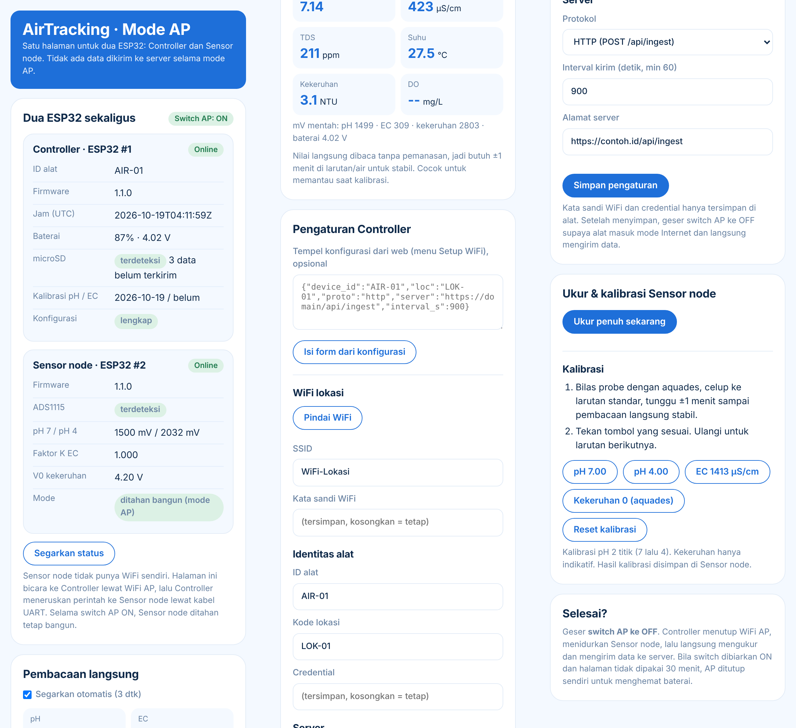

Untuk melihatnya tanpa alat, buka `firmware/ap_page.html` di browser dengan tambahan `?demo` (data contoh). Screenshot di atas diambil dengan cara itu, jadi nilainya hanya contoh.

---

## Catatan tentang screenshot

Screenshot dibuat dari berkas `public/css` dan `public/js` proyek serta data contoh di `database/database.sqlite` (4 alat dan 360 data dari `DemoSeeder`). Karena font Outfit dimuat dari Google Fonts, tampilan di browser dengan internet akan memakai Outfit; pada screenshot ini huruf cadangan sistem yang terpakai, sehingga bentuk huruf dan lebar teks bisa sedikit berbeda.
